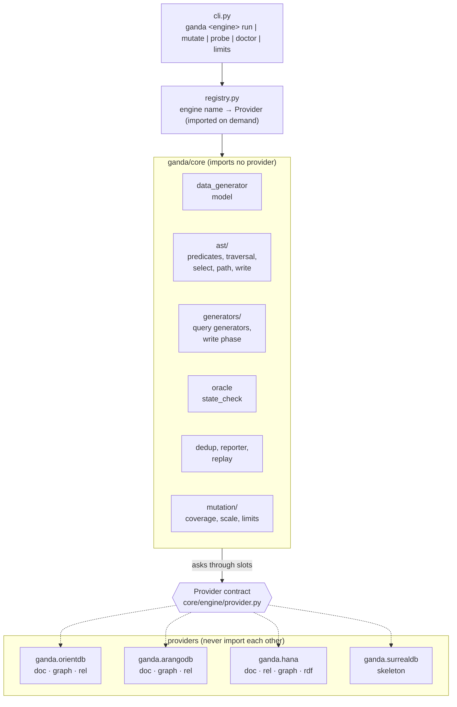
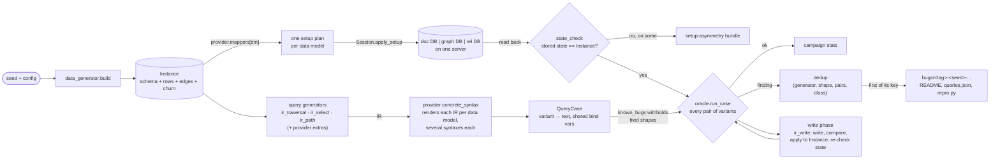

# Architecture

Ganda is a metamorphic fuzzer for multi-model database engines. A multi-model engine
promises that one dataset can be stored as documents, as a graph or as relational
tables, and queried in each form. Ganda turns that promise into a test oracle:

1. generate one abstract property graph (the **Instance**) from a seed;
2. store it once per **data model** of the engine, in separate databases on one server;
3. ask every database the same question, through several **concrete syntaxes** each;
4. require every pair of answers to agree.

The oracle is purely differential: no answer is predicted from the Instance, so a
fault every data model and every syntax shares is out of reach by design.

## The two layers

The core never imports a provider, and providers never import each other
(`tests/test_layering.py` enforces both). The core reaches the engine through the
provider object a schema was generated for (`Schema.engine`), a case's
`QueryCase.engine`, or an argument passed in. There is no global "current engine", so
two engines can run in one process.

The single most important rule: **engine behaviour never lives in the core.** If a line
is only true for one engine (what `null + 1` is, where nulls sort, which index kind is
unique), it belongs behind a slot of the provider contract.

## One seed, end to end

`core/campaign/run.py::run_instance` is the whole pipeline for one seed. Reading it top to
bottom is the fastest way to understand Ganda.

Step by step:

| Step | Code | What happens |
|---|---|---|
| Generate | `core/data/generator.py`, `core/data/model.py` | `build(seed, cfg, engine)` returns `(schema, instance, rng)`. The Instance is a small labelled property graph: node classes, edge types, rows, plus *churn* (records written then updated or deleted, so write paths get exercised). |
| Map | `<engine>/mapping/` | Each data model's mapper turns the Instance into a **setup plan**: a list of provider-defined steps (`@step("op")` in `core/engine/setup_plan.py`). Records are named by logical id; an engine-assigned id is a `Ref(id)` placeholder resolved at run time. |
| Materialize | `<engine>/connection.py` | `Server.fresh_session(db)` gives an empty database per data model; `Session.apply_setup(plan)` runs the plan. |
| Compare state | `core/engine/state_check.py` | Read every database back and compare the data models with each other. The data model off the consensus is the one with the problem (a tie names every one); a diff on one data model only is an engine write-path finding. |
| Sample questions | `core/query/generators/` | Each query generator draws IRs from its own random stream. |
| Render | `<engine>/concrete_syntax/` | The provider turns an IR into text for each data model, through every concrete syntax that applies. |
| Compare | `core/oracle/oracle.py` | Every variant runs on its data model's session. Answers are normalized (row folding, multiset order) and compared pair by pair. |
| Write phase | `core/query/generators/write_phase.py` | After the reads, predicate-targeted writes run on every data model. Their answers are compared, the write is applied to the Instance (which later draws read from), and the stored states are compared again. |
| Report | `core/oracle/dedup.py`, `core/campaign/reporter.py` | The first finding per key becomes a self-contained bundle with a `repro.py`. |

`--workers N` runs N shards of seeds as threads against the same server, each in its own
database namespace. A crash (`EngineCrash`) is autopsied (`Server.diagnostics`) and the
server is restarted.

## The core vocabulary in code

### Variants and cases

A `QueryCase` (`core/oracle/case.py`) is one question. Its `queries` map **variant → text**,
where a variant is either a data model (`doc`, `graph`, `rel`) or
`<data model>:<tag>`, a second concrete syntax run in that data model's database
(`graph:match`, `rel:flat`, `rel:pull_up`). Values travel in `bind_vars`, shared by every
variant.

Because the oracle compares *every pair*, one case produces two kinds of evidence:

- **same-database pairs** (`graph/graph:match`): two engine paths over one storage
  layout, no cross-model confound at all;
- **cross-model pairs** (`doc/rel`): two storage layouts, which tests the multi-model
  promise.

### The four query IRs (`core/query/ir/`)

| IR | Question |
|---|---|
| `traversal.py` | Start class, 1 to `MAX_HOPS` hops (`out` / `in` / `both`), predicates on edges or targets, a projection |
| `select.py` | One class or edge type, an optional filter, a result kind (`ids`, `count`, `agg`, `group`, `page`, `join`, ...), optionally inside a rolled-back transaction |
| `path.py` | Vertex count of a shortest path between two records |
| `write.py` | Update / delete / upsert by predicate, edge attribute writes |

The IRs walk the Instance only to steer generation: a filter that keeps some records,
a write that matches some, a sum that stays exact, and `write.apply` keeps the Instance
in step with the databases so later questions draw their constants from current data.

`predicates.py` holds the predicate tree all four share. Constants are drawn *on*, *next to*
or *outside* stored values, because bugs live at boundaries.

### Comparison modes

`Comparison` in `core/oracle/case.py` says how answers are normalized: `SCALAR_BY_ID`,
`MULTISET_BY_ID`, `SET_BY_ID`, `SINGLE_VALUE`, `NESTED_VALUE`. Normalization strips only
representation artifacts (one row per path folded into one entry per id, nested lists
flattened, nulls dropped from multisets). Numbers are **not** collapsed across types:
`5` against `5.0` is a divergence.

### Finding classes

From `CaseResult.finding_class` (`core/oracle/oracle.py`), most severe first:

| Class | Meaning |
|---|---|
| `internal_error` | A raw exception from inside the engine. A finding on its own. |
| `error_asymmetry` | Some variants errored, others answered. |
| `duplicate_id_rows` | A scalar answer returned one id twice. |
| `mismatch` | Two variants answered differently. `failing_pairs` says which. |

Setup problems are reported separately: `setup-asymmetry`, `state-diff`, `state-leak`
(a rolled-back transaction leaked) and `write-state-<step>`.

## The provider contract

`core/engine/provider.py` documents every member. A provider is a `Provider` subclass whose
attributes are **slots** the core reads; a slot may be an object or a module.

| Slot | What the core asks it | Typical file |
|---|---|---|
| `name`, `title`, `data_models`, `config_class` | Identity, storage models in comparison order, configuration (each field becomes a CLI flag) | `provider.py`, `config.py` |
| `limits` | `StorageLimits`: longest string, record size, request size, ... | `engine/limits.py` |
| `server()` → `Server` / `Session` | Start or attach; run a setup plan; execute a text; read stored state back | `engine/connection.py` |
| `mappers[data model]` | Instance → setup plan | `storage/mapping/` |
| `physical_design` | Index kinds, write forms, key rules, boundary values | `storage/physical_design.py` |
| `semantics` | Value order and equality, predicate truth, null logic, aggregates, null placement | `oracle/semantics.py` |
| `predicate_sampling` | Which operators a predicate draws; cross-type constants; leaf forms | `concrete_syntax/query/predicate_sampling/` (OrientDB), `oracle/predicate_sampling.py` (ArangoDB, HANA) |
| `traversal_syntax`, `select_syntax`, `path_syntax`, `write_syntax` | Which concrete syntaxes apply to an IR, and their text | `concrete_syntax/` |
| `rewrites` | Equivalent rewrites of a predicate; exactness of arithmetic | `oracle/rewrites.py` |
| `known_bugs` | Filed bugs, withheld at their exact shape per variant | `known_bugs/guards.py` |
| `mutants` | The engine's own corruptions for the mutation benchmark | `mutation/mutants.py` |
| `coverage()` | A code-coverage collector, or `None` | `engine/coverage.py` |
| `extra_generators` | Engine-only query generators | |
| `compare_despite_errors`, `partial_traversals`, `error_signature` | Oracle options (off by default; HANA turns them on) | `provider.py` |

Every provider has the same layout, so once you know one you can find your way in
the others. `tests/fake_engine/` is a complete provider in a few hundred lines: an
in-memory engine whose sessions answer from the IR evaluators. Read it to see the
contract with nothing engine-specific in the way.

### Engines today

| Engine | Data models | Status | Engine facts |
|---|---|---|---|
| OrientDB | `doc` (embedded links), `graph` (edges), `rel` (junction classes) | Full. Seed-for-seed equal to the legacy `../OrientDB` fuzzer | `ganda/orientdb/RULES.md` |
| ArangoDB | `doc` (link arrays), `graph` (edge collections), `rel` (junction collections) | Full, verified live on 3.12.11 | `ganda/arangodb/rules/catalog.py` (rendered: `ganda/arangodb/rules/RULES.md`) |
| SAP HANA | `doc` (Document Store), `rel` (column tables), `graph` (Property Graph Engine, openCypher), `rdf` (Knowledge Graph Engine, SPARQL) | Full, verified live on HANA Cloud | `ganda/hana/rules/catalog.py` (rendered: `ganda/hana/rules/RULES.md`) |
| SurrealDB | `doc`, `graph`, `rel` | Skeleton: connection layer only | `ganda/surrealdb/PORTING.md` |

## Invariants that keep results trustworthy

These are why a finding can be blamed on the engine. Break one and every result after
it is suspect.

1. **The stored state *is* the Instance.** `state_check` proves it live before any
   question is asked, and again after every write.
2. **Every engine fact is probed.** Each rule in a provider's `oracle/semantics.py` or
   concrete syntax should come from a live probe (`ganda <engine> probe`) and be listed
   in that provider's `rules/catalog.py` as a typed record (rendered by `ganda <engine>
   rules`; a skeleton provider may start with a `RULES.md`). When a probe fact fails, the
   provider changes, never the probe.
3. **Randomness is in named streams** (`core/rng.py`). Every consumer draws from
   `stream(seed, name)`, so adding a draw in one place never shifts another. A new axis
   draws from a new *tail* stream behind a probability that defaults to 0. That is what
   makes a seed reproduce forever and what lets a smaller bound shrink the data without
   reshuffling it.
4. **Query generator ids are stream names.** `ir_traversal`, `ir_select`, `ir_path`,
   `ir_write` name random streams; renaming one changes every seed.
5. **Known bugs are withheld, not ignored.** A variant whose text has the exact shape of
   a filed bug is skipped and counted (`known bugs withheld` in the stats), so a known
   defect does not bury new ones. `--no-known-bugs` runs them again.

## Beyond a plain campaign

- **Mutation benchmark** (`core/mutation/`, `ganda <engine> mutate`): corrupt one piece
  on purpose (one data model's Instance, one variant's text, an index path) and measure
  how often the oracle catches it. Real bugs are rare, so this is how a change to the
  query supply is judged. Compare catch rates over the *same* mutants and seeds.
- **Scale** (`core/data/scale.py`, `core/data/limits.py`, `--scale large`): thousands of records,
  hubs of thousands of edges, values grown to the engine's limits, bulk writes. State is
  compared by counts plus a sample, and a query timeout is "no answer" rather than an
  error.
- **Coverage** (`core/engine/coverage.py`, `--coverage seed|case|variant`): a hook protocol;
  OrientDB implements it with JaCoCo.
- **Replay** (`core/campaign/replay.py`): a bundle's `repro.py` regenerates the Instance
  from the seed and re-runs the case.

## Where to read next

- [contributing.md](contributing.md): setup, the gates every change passes, and how-tos.
- [glossary.md](glossary.md): every term used here.
- `ganda/core/engine/provider.py`: the contract, member by member.
- `ganda/core/campaign/run.py::run_instance`: the pipeline in about 120 lines.
